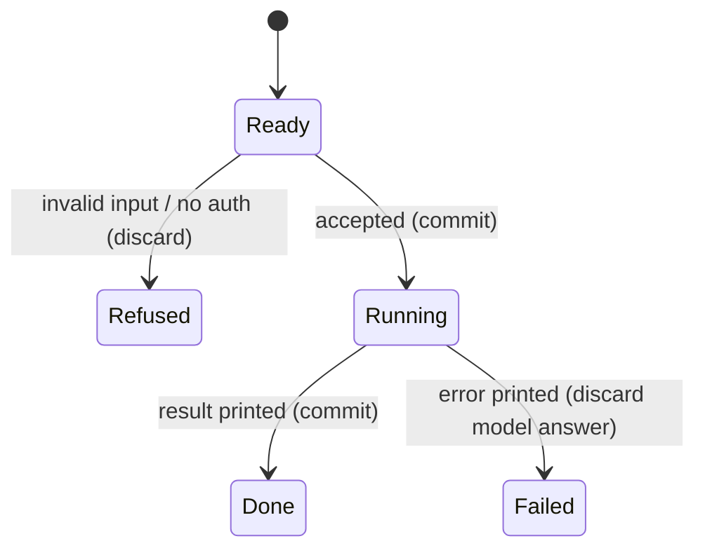

# The command lifecycle

## Summary

Every Imprint action is one command: a CLI process or one HTTP request. The user starts it with arguments or a JSON body. It either refuses at once or waits until Git, disk, and optionally a model finish. There is no progress stream.

Reached from `bun src/cli.ts …` in a Git checkout, or from `https://imprint-api.coey.dev`. Active while the process or request is open. Unavailable without a Git checkout (CLI) or without a public GitHub repository and SHA (Worker).

## The simple case

The user runs a command with a valid commit and, if asking, a configured model. Imprint resolves the commit, seals or reuses a release, optionally calls the model, prints JSON, and exits 0.

## The interaction, event by event

### Starting

The user names a subcommand or POSTs JSON. Imprint captures the working directory (CLI) or repository/commit/question (Worker). Variant set: slice flags, auth, body size.

### Ending at once

Unknown CLI command prints usage and does not write a release. Missing Worker fields return 400. Unauthenticated Worker ask returns 401. Oversized Worker body returns 413. Empty slice throws before a model call.

### Becoming extended

Git `rev-parse`, `ls-tree`/`grep`, file reads, or `AI.run` has started. The commit and slice key are fixed for this command.

### While extended

The terminal or HTTP connection stays open. No tokens stream. The user can abort the process or client.

### Finishing

JSON on stdout or in the HTTP body. A release file may have been written. Failure prints a message and sets exit 1, or returns JSON `{ error }` with HTTP 400.

## Modifiers

| Variant | Set at the start | Changed while extended |
|---|---|---|
| Slice grep/paths | Changes which files are sealed. | No effect. |
| Existing release file | Open reuses it and skips a new seal. | No effect. |
| Provider / Worker token | Ask refused without it. | No effect. |
| DEV_MODE | Worker skips the bearer gate. | No effect. |

## Cancel and interrupt

| Event | Before extended | While extended |
|---|---|---|
| Explicit abort | Nothing written. | Partial release file may exist if imprint already wrote; model answer discarded. |
| Different action | Other command starts independently. | Two commands may race on the same release path. |
| Environment failure | Command never starts. | Error, exit 1 / HTTP 400. |
| Target changes | New tree is what gets sealed. | In-flight command keeps the commit it already resolved. |
| Input channel changes | Nothing. | Connection drop discards the answer for the user; a release already written stays. |

Left in: the checkout as it was, plus any release files already flushed.

## Interactions with other systems

**Permissions.** CLI needs a readable Git directory. Worker POST needs the ask bearer. GET needs none.

**History.** Release JSON under `.imprint/releases/` is the history. The Worker does not persist a release.

**Containers and runtime.** Worker runs on Cloudflare Workers AI. CLI runs on the user's machine.

**Locked or read-only state.** A read-only checkout fails when imprint tries to write `.imprint/`.

**Offline.** CLI imprint can work offline. Ask and Worker need network.

**Collaboration.** Two users sharing a checkout share release files. No locking.

**Notifications.** None.

**Preferences.** `maxSourceBytes`, provider, Worker `AI_MODEL`, `ASK_API_TOKEN`, `GITHUB_TOKEN`.

## Edge cases

- CLI `client()` is constructed before the command runs. `prove` and `ask` both need gateway env even if the user only wanted `imprint`.
- Worker GET never asks a model.

## Open questions and verification

- Whether a SIGINT mid-write leaves truncated JSON was not exercised.
- Whether two parallel `imprint` of the same slice can tear the file was not exercised.

Verified against `/Users/jcoeyman/cloudflare/imprint` commit `3ce8ead166bdc824c91d1a3c66ff63b9cf94603f` plus the dirty working tree and live Worker `c6b93e09-e3c1-4791-a82a-5ddd490026dc`.
