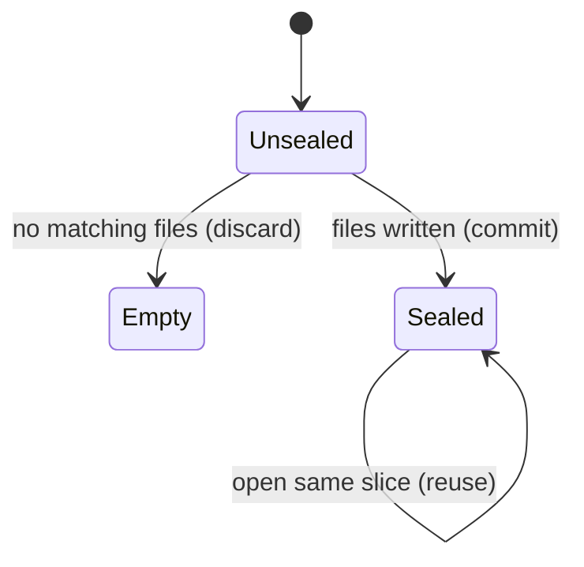

# The release and the slice

## Summary

A release is the sealed record of one commit and one slice: which files, their bytes, two digests, and proof checks. A slice is either the full A–Z window or an explicit path list / literal grep. Later asks only see those files.

The user meets this whenever they imprint, open, inspect, or ask. It is active as the JSON under `.imprint/releases/`. Available whenever Git can resolve the commit.

## The simple case

The user imprints HEAD. Imprint writes `.imprint/releases/<sha>.json` with text files in path order until 400 KB. Proof is verified unless a file contains `IMPRINT_BROKEN`.

## The interaction, event by event

### Starting

The user passes a ref and optional `{ grep }` or `{ paths }`. Paths win over grep if both are set.

### Ending at once

No supported files, or a slice that matched nothing: error, no release.

### Becoming extended

Git lists the tree. Files over 128 KB and non-text extensions are skipped. Remaining files sort by path.

### While extended

Contents are read with `git show`. Budget 400_000 bytes (library) or 40 files / 300_000 (Worker).

### Finishing

Release JSON written. Slice key `full` uses `<commit>.json`. Otherwise `<commit>.<16-hex>.json`. Digest includes the slice key, so a slice is never the same id as the full tree.

## Modifiers

| Variant | Set at the start | Changed while extended |
|---|---|---|
| grep | Only matching files. Empty match fails. | No effect. |
| paths | Only those paths that exist and are text. | No effect. |
| maxSourceBytes | Smaller stuffed window. | No effect. |
| Worker vs library | Worker also caps 40 files and 64 KB per blob. | No effect. |

## Cancel and interrupt

| Event | Before extended | While extended |
|---|---|---|
| Explicit abort | No file. | File may be missing or complete. |
| Different action | Independent. | May overwrite the same path. |
| Environment failure | No file. | Error. |
| Target changes | New commit if ref moves. | Already-resolved commit stays. |
| Input channel changes | Nothing. | User loses the printed result. |

## Interactions with other systems

**Permissions.** Write access to `.imprint/`.

**History.** One file per commit+slice. No versions inside a file.

**Containers and runtime.** Local Git. Worker fetches GitHub blobs and does not write a release.

**Locked or read-only state.** Cannot seal.

**Offline.** Local yes. Worker no.

**Collaboration.** Shared files, no merge.

**Notifications.** None.

**Preferences.** Extension list and budgets in [goal.md](../goal.md) established facts.

## Edge cases

- A stuffed full snapshot can omit a file that `git grep` still finds. That is the point of a slice.
- Worker grep scans only the first 200 A–Z candidates, then keeps at most 40 hits. A late-alphabet match can be missed even with grep.
- Library grep uses the whole tree via `git grep`.
- `.astro` is text in the library. The Worker regex also includes `astro`.

## Open questions and verification

- Worker late-alphabet grep miss is inferred from the 200-candidate cap, not proven live.
- Looks like a product gap: Worker slice is not a stored release, so there is no digest to share.

Verified against `/Users/jcoeyman/cloudflare/imprint` commit `3ce8ead166bdc824c91d1a3c66ff63b9cf94603f` plus the dirty working tree.
