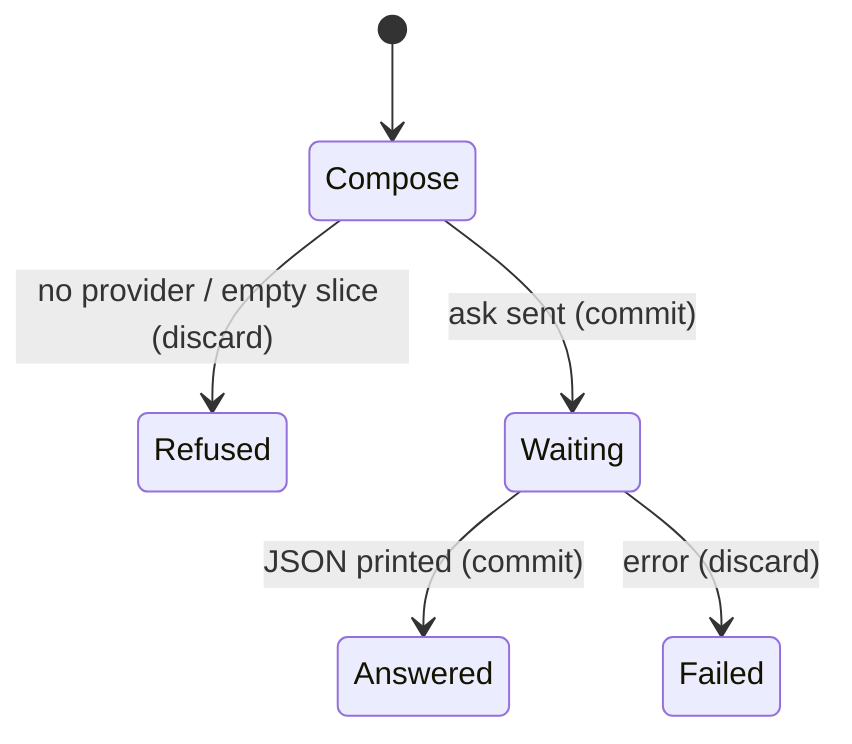

# Ask on a slice

## Summary

Ask sends one question to a model together with one already sealed snapshot. The answer may only honestly cite files in that snapshot. If the plant is outside the stuffed window, a full ask says it is absent; a grep slice that includes the plant can name the path.

Reached as `imprint ask [--grep N] [--path P] [@ref] <question>` or `repo.ask(question)` after `open`. Active while the model request is in flight. Unavailable without a provider (library) or ask bearer (Worker).

## The simple case

The user opens a commit with `{ grep: plant }` and asks where that string is defined. The printed answer contains `web/src/pages/index.astro`. Citations list that path if the model text includes it.

## The interaction, event by event

### Starting

The user supplies a question and optional slice. Open seals or reuses the release. The snapshot text is fixed.

### Ending at once

No provider: `ask requires a model provider`. Empty slice: no ask. CLI without gateway env: process throws before the subcommand.

### Becoming extended

The model request starts. Max tokens 800.

### While extended

No tokens appear. The user can kill the process.

### Finishing

JSON: `text`, `citations`, `release` id/commit/digest, `model`, `usage`. Citations are sealed paths that occur as substrings in `text`, not model-declared citations.

## Modifiers

| Variant | Set at the start | Changed while extended |
|---|---|---|
| Full vs grep vs paths | Changes what the model can see. | No effect. |
| `@ref` | Which commit. | No effect. |
| Question text | Prompt only. | No effect. |
| Model | CLI from env; Worker from `AI_MODEL`. | No effect. |

## Cancel and interrupt

| Event | Before extended | While extended |
|---|---|---|
| Explicit abort | No model call. Release may already exist from open. | Answer discarded. Release remains. |
| Different action | Independent. | Independent. |
| Environment failure | Error, no answer. | Error, no answer. |
| Target changes | New open would reseal if the file is missing. | In-flight ask keeps the old snapshot. |
| Input channel changes | Nothing. | User does not see the JSON. |

## Interactions with other systems

**Permissions.** Model credentials. Worker bearer.

**History.** The release file is the record. Ask itself is not stored.

**Containers and runtime.** Employee gateway only if the user sets `AI_GATEWAY_URL`. Public Worker uses Workers AI Kimi.

**Locked or read-only state.** Open may fail if it must imprint.

**Offline.** Ask fails.

**Collaboration.** None.

**Notifications.** None.

**Preferences.** Provider and model env.

## Edge cases

- Stuffed full ask on E6 SHA A answers `NONE` for a plant in `index.astro`.
- Slice A with the old plant answers the path. Asking that same slice for the new plant answers `NONE`.
- The model is instructed to say when the answer is absent. The product does not parse or force `NONE`.
- Worker ask does not return `citations`. It returns `selectedFiles` and raw `result`.

## Open questions and verification

- Citation substring matching can false-positive if the model mentions a path that was sealed but not used. Not proven harmful.
- Live Worker slice was not called with a valid bearer in this pass.

Verified against `/Users/jcoeyman/cloudflare/imprint` commit `3ce8ead166bdc824c91d1a3c66ff63b9cf94603f` plus dirty tree; E6 via `check-e6.sh` (`E6_OK`).
