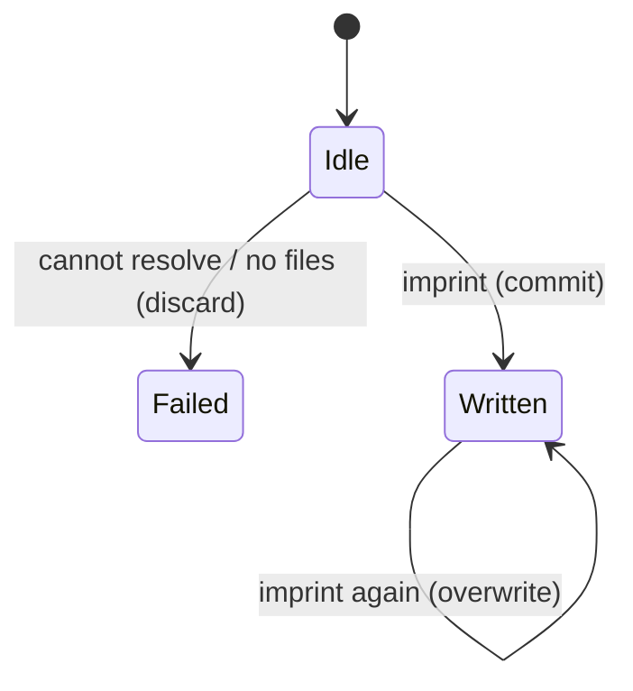

# Imprint a commit

## Summary

Imprint resolves a Git commit, selects text files (full window or slice), writes a release, and returns it. Open does the same when the release file is missing.

Reached as `imprint imprint [ref]` or `imprint.open(ref, slice)`. Active while Git reads run. Needs a Git directory.

## The simple case

The user runs `imprint imprint HEAD`. JSON for a candidate release is printed. `.imprint/releases/<sha>.json` exists.

## The interaction, event by event

### Starting

Ref defaults to HEAD. Optional slice.

### Ending at once

Unknown ref or empty file set: error, no JSON file.

### Becoming extended

Resolve, parents, identity, file read.

### While extended

No progress. User can abort.

### Finishing

Candidate release on disk. Status stays `candidate` until promote.

## Modifiers

| Variant | Set at the start | Changed while extended |
|---|---|---|
| Slice | Separate file and digest. | No effect. |
| Existing file | Open reuses; imprint overwrites. | No effect. |

## Cancel and interrupt

| Event | Before extended | While extended |
|---|---|---|
| Explicit abort | Nothing. | Partial file possible. |
| Different action | Independent. | Race on the same path. |
| Environment failure | Error. | Error. |
| Target changes | New HEAD if using HEAD. | Resolved commit stays. |
| Input channel changes | Nothing. | Lost stdout. |

## Interactions with other systems

**Permissions.** Git + write `.imprint`.

**History.** One file per commit+slice.

**Containers and runtime.** Local Git only.

**Locked or read-only state.** Fails on write.

**Offline.** Works.

**Collaboration.** No lock.

**Notifications.** None.

**Preferences.** `maxSourceBytes`, custom checks.

## Edge cases

- CLI `imprint` does not accept `--grep`. Only `ask` does. To seal a slice without asking, use the library.
- `IMPRINT_BROKEN` still writes a release; `proof.verified` is false.

## Open questions and verification

- CLI cannot imprint a slice. Looks like a product gap, not a library gap.

Verified against `/Users/jcoeyman/cloudflare/imprint` commit `3ce8ead166bdc824c91d1a3c66ff63b9cf94603f` plus dirty tree.
