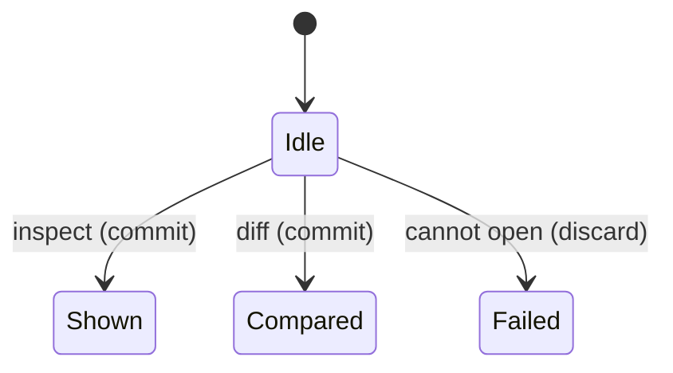

# Inspect and diff

## Summary

Inspect prints one release. Diff opens two commits (full snapshots) and lists added, deleted, and changed paths by blob id.

Reached as `imprint inspect [ref]` and `imprint diff <from> <to>`. Active while open/imprint runs. Needs Git.

## The simple case

The user diffs two imprinted commits and sees which paths changed.

## The interaction, event by event

### Starting

Inspect uses the given ref or the active/HEAD commit. Diff needs two refs.

### Ending at once

Missing refs: usage or Git error.

### Becoming extended

Each side `open`s (may imprint).

### While extended

No progress.

### Finishing

Inspect: full release JSON. Diff: `{ from, to, added, deleted, changed }`.

## Modifiers

| Variant | Set at the start | Changed while extended |
|---|---|---|
| Never imprinted | Open imprints full. | No effect. |
| Slice | CLI inspect/diff have no slice flags. | No effect. |

## Cancel and interrupt

| Event | Before extended | While extended |
|---|---|---|
| Explicit abort | Nothing. | Side-effect imprint may exist. |
| Different action | Independent. | Independent. |
| Environment failure | Error. | Error. |
| Target changes | New resolve. | Resolved commits stay. |
| Input channel changes | Nothing. | Lost stdout. |

## Interactions with other systems

**Permissions.** Read Git; write if imprint is needed.

**History.** None beyond releases.

**Containers and runtime.** Local.

**Locked or read-only state.** Inspect of an existing file works; first open may fail.

**Offline.** Works.

**Collaboration.** None.

**Notifications.** None.

**Preferences.** None.

## Edge cases

- Diff compares only files that made it into each stuffed window, not the whole Git tree.
- Diff does not accept slices.

## Open questions and verification

- Not run by hand in this pass; covered by library types and `imprint.diff` implementation.

Verified against `/Users/jcoeyman/cloudflare/imprint` commit `3ce8ead166bdc824c91d1a3c66ff63b9cf94603f` plus dirty tree.
