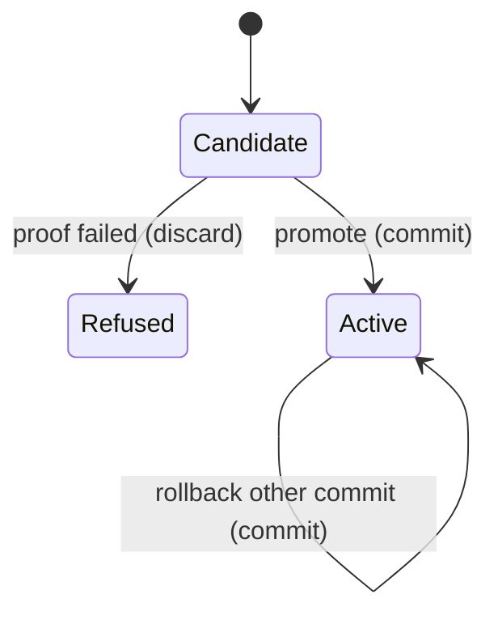

# Promote and rollback

## Summary

Promote marks a verified **full** release as active and writes `.imprint/active` with that commit. Rollback is the same operation on another commit. Slices cannot be promoted.

Reached as `imprint promote <ref>` and `imprint rollback <ref>`. Active while the two files are written. Needs an existing full release.

## The simple case

The user imprints two commits, promotes the new one, then rollbacks the old one. `open()` with no ref follows the pointer.

## The interaction, event by event

### Starting

Ref is resolved. Only the `full` release file is read.

### Ending at once

Missing file: read error. `proof.verified` false: `did not verify`.

### Becoming extended

Status set to `active`. Files written.

### While extended

Brief disk write.

### Finishing

`active` contains the commit plus newline. Next bare `open()` uses it.

## Modifiers

| Variant | Set at the start | Changed while extended |
|---|---|---|
| Unverified release | Refused. | No effect. |
| Slice release | Ignored; only `full` is read. | No effect. |

## Cancel and interrupt

| Event | Before extended | While extended |
|---|---|---|
| Explicit abort | Pointer unchanged. | Pointer and release status may disagree if one write finished. |
| Different action | Independent. | Last writer wins. |
| Environment failure | Unchanged. | Unchanged or half-written. |
| Target changes | Resolves now. | Already resolved. |
| Input channel changes | Nothing. | Lost stdout. |

## Interactions with other systems

**Permissions.** Write `.imprint`.

**History.** Release status field plus `active` file. No log.

**Containers and runtime.** Local.

**Locked or read-only state.** Fails.

**Offline.** Works.

**Collaboration.** Last write wins.

**Notifications.** None.

**Preferences.** None.

## Edge cases

- Rollback does not restore an old status on the displaced release. Both can read as `active` in their JSON; only `active` file matters for `open()`.
- Looks like a bug: status is not uniquely “the” active release.

## Open questions and verification

- Half-written `active` not exercised.

Verified against `/Users/jcoeyman/cloudflare/imprint` commit `3ce8ead166bdc824c91d1a3c66ff63b9cf94603f` plus dirty tree and `test/imprint.test.ts`.
