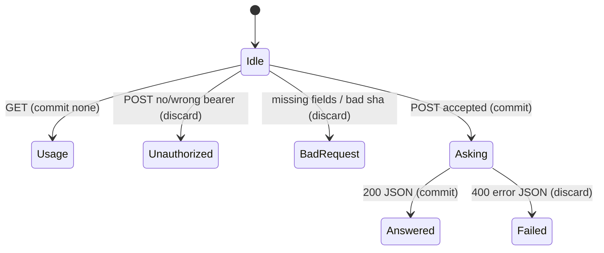

# Public Worker ask

## Summary

The public Worker answers one question about a public GitHub commit. GET shows how to call it. POST seals a stuffed or sliced snapshot in memory and calls Workers AI. Nothing is written to the caller's disk.

Reached at `https://imprint-api.coey.dev`. GET is always available. POST is available only with `Authorization: Bearer $ASK_API_TOKEN`.

## The simple case

The user GETs the URL and sees usage JSON. They POST repository, commit, question, and a bearer. They receive `selectedFiles`, `model`, and `result`.

## The interaction, event by event

### Starting

GET: no body. POST: JSON with `repository`, `commit`, `question`, optional `grep`, `paths`.

### Ending at once

Wrong method: 405. No `ASK_API_TOKEN` configured: 503. Bad bearer: 401. Body > 16_000: 413. Missing fields: 400. Question > 2_000: 400. Grep > 200: 400. Non-SHA commit: 400.

### Becoming extended

GitHub tree + blobs. Then Workers AI. Model default `@cf/moonshotai/kimi-k2.7-code`. Qwen names refused.

### While extended

Connection stays open. No stream.

### Finishing

200 JSON with repository, commit, model, via (`workers-ai` or `ai-gateway`), selectedFiles, result. Failures: `{ error: message }` 400.

## Modifiers

| Variant | Set at the start | Changed while extended |
|---|---|---|
| grep / paths | Smaller in-memory snapshot. | No effect. |
| GITHUB_TOKEN | Higher GitHub rate limit. | No effect. |
| AI_MODEL | Must not match qwen. | No effect. |
| DEV_MODE=true | No bearer required. | No effect. |

## Cancel and interrupt

| Event | Before extended | While extended |
|---|---|---|
| Explicit abort | Nothing stored. | Model may still run; user sees no body. |
| Different action | Independent requests. | Independent. |
| Environment failure | 400/401/503. | 400 with GitHub or model message. |
| Target changes | New GitHub tree. | In-flight tree stays. |
| Input channel changes | Nothing. | Lost response. |

## Interactions with other systems

**Permissions.** GET public. POST bearer. Adapter routes use a separate adapter token (out of scope).

**History.** None.

**Containers and runtime.** Cloudflare Worker + Workers AI. Not the employee OpenCode gateway.

**Locked or read-only state.** No interaction.

**Offline.** Unreachable.

**Collaboration.** Shared Worker quota.

**Notifications.** None.

**Preferences.** Worker secrets and `AI_MODEL`.

## Edge cases

- GET 200 with no auth is intentional usage JSON. Guardrail flags it as OPEN.
- Private GitHub repos are not accepted.
- Slice is not persisted; there is no `sourceDigest` in the response.

## Open questions and verification

- Authenticated POST with a real token was not run in this pass.
- GET and unauthenticated POST were run 2026-08-24.

Verified against live Worker `c6b93e09-e3c1-4791-a82a-5ddd490026dc` and `/Users/jcoeyman/cloudflare/imprint` commit `3ce8ead166bdc824c91d1a3c66ff63b9cf94603f` plus dirty `src/worker.ts`.
